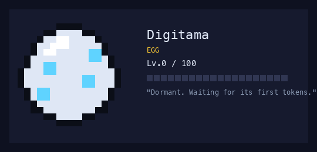
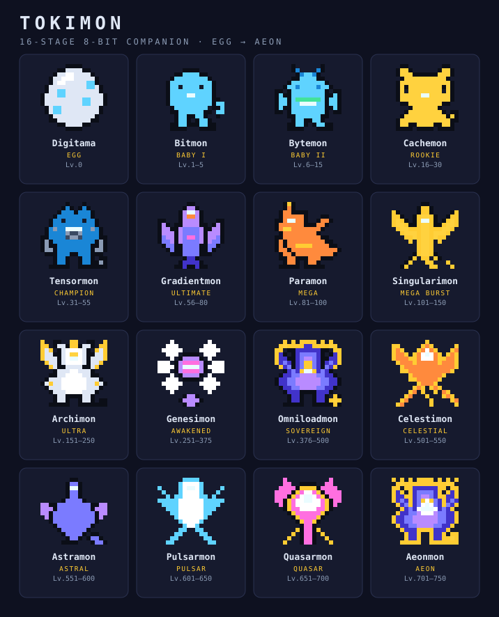

# 🥚 Tokimon — an 8-bit token companion for the Claude Code status bar

[](https://github.com/jekleb/digimon-companion/actions/workflows/tests.yml)
[](LICENSE)


A token-fueled virtual pet that lives in your Claude Code **status line**. It
evolves as you actually spend tokens, springs into a **training animation with
whatever subagent is running**, and **rebirths** when it hits the level ceiling —
banking a prestige rank that recolors it and speeds the next climb.

Pure Python standard library. No dependencies. Everything is local — no network,
no servers, no telemetry.

<p align="center">
  
  <br><em>Evolve as you spend tokens → hit the Lv.750 ceiling → rebirth shiny, one prestige higher.</em>
</p>

<p align="center">
  
</p>

```
🥚·  Tokimon · Digitama Lv.0/100 [░░░░░░░░░░] 0 tok          ← fresh egg, resting
🔷✦  Tokimon · Tensormon Lv.42/55 [████▉░░░░░] 88.4M tok      ← idle, mid-game
🌌⚔️✍️ Tokimon training w/ Ekleberry · Lv.456 [██▎░░░░] ⏱2m    ← sparring with a subagent
✨ REBIRTH! Tokimon reborn as 🥚 Digitama — Prestige ★ (+6% growth)
```

---

## What it does

- **Lives in the bar** — a compact, animated one-liner: stage emoji, name, level,
  a "charging" XP bar, and a human-readable token count.
- **Fueled by real usage** — a `Stop` hook reads only the *new* bytes of the
  session transcript each turn and sums genuine token usage (input + output +
  cache).
- **Trains with the active agent** — while a subagent (Task/Agent tool) is
  running, the pet is shown sparring with it, agent-by-agent, with a live timer.
- **16-stage evolution tree** — Egg → … → Sovereign → Celestial → … → **Aeon**
  (Lv.750 ceiling), each with its own 8-bit pixel sprite.
- **Prestige / rebirth** — hit the ceiling and it resets to the Egg, banking a
  tiered ★ badge (★ → ✦ → ✧ → ❖), a permanent **+6% growth per rank**, and a
  **shiny hue-shifted recolor** so every life looks different.

---

## Install

Requires **Python 3.9+** on macOS/Linux (uses `fcntl` for file locking).

Clone anywhere, then wire two entries into `~/.claude/settings.json`
(replace `PATH` with wherever you cloned it):

```jsonc
{
  "statusLine": {
    "type": "command",
    "command": "python3 PATH/digimon-companion/digimon_statusline.py 2>/dev/null"
  },
  "hooks": {
    "Stop": [
      {
        "hooks": [
          {
            "type": "command",
            "command": "python3 PATH/digimon-companion/digimon_hook.py 2>/dev/null || true",
            "timeout": 15
          }
        ]
      }
    ]
  }
}
```

Then run `python3 digimon_cli.py doctor` — it verifies the wiring end-to-end.

Persistent state lives in `~/.claude/digimon/state.json` (created automatically);
it is never stored in the repo.

---

## Commands

```
python3 digimon_cli.py <command>
```

| Command | What it shows |
|---|---|
| `status` | Full readout: sprite, level, XP, prestige, next evolution |
| `gallery` | Every stage's sprite, "you are here" marked |
| `history` | Evolution + rebirth log |
| `sessions` | Per-project token spend (sanity-check the curve) |
| `agents` | The subagent → icon/label map + who's training now |
| `bar` | Preview one frame of the exact status-bar line |
| `live [agent]` | Full-screen animated scene (`live cosmic-code` simulates a training session) |
| `doctor` | Self-check: hooks wired, data valid, sprites valid, scripts run |
| `rename <name>` | Rename your companion |

---

## How it works

| File | Role |
|---|---|
| `digimon_lib.py` | Engine — XP curve, level/stage math, prestige & rebirth, atomic state + file locking, formatters, validators |
| `digimon_hook.py` | `Stop` hook — tallies new token usage, evolves, rebirths at the ceiling, emits an evolution/rebirth message |
| `digimon_statusline.py` | The animated one-line status-bar readout |
| `digimon_agents.py` | Detects the active subagent by parsing the transcript tail (async-aware; byte-prefiltered hot path) |
| `digimon_sprites.py` | 8-bit half-block sprite renderer, shiny prestige recolor, agent styles, animation frames |
| `digimon_cli.py` | The human-facing viewer/CLI |
| `tokimon_feed.py` | JSON snapshot feed (stage, XP, sprite, palette, live agents) for the menu-bar app |
| `menubar/main.swift` | The macOS menu-bar app — see [menubar/README.md](menubar/README.md) |
| `evolution_data.json` | 16 stages, the level curve, cap tiers, 20-color palette, and two-frame pixel sprites |

A few design notes:

- **Agent detection reads the transcript, not hooks.** Most subagents run
  *async* — their tool result returns at launch, and completion arrives later as
  a `task-notification` that fires no hook. The transcript is the one place that
  reflects true running/finished state for both sync and async agents, and it's
  self-correcting (no state to get stuck).
- **The status line never crashes your prompt.** Any error falls back to a
  minimal line and is logged to `~/.claude/digimon/error.log`.
- **8-bit sprites** are stored as a grid of palette-key characters + a shared
  palette, rendered with the half-block (`▀`) trick so pixels come out square
  and the vertical resolution doubles. Falls back to a monochrome silhouette
  on terminals without truecolor.
- **Creatures, not blobs.** The tree is drawn on a 16×16 grid so stages can have
  arms, legs, wings and tails: egg → slime → imp → quadruped → bipedal dino →
  bird → winged dragon → celestial forms. 12×12 had no room for a limb, which is
  why the early sprites were symmetric blobs with features hung on them.
- **Every stage is a two-frame loop** — a blink, an aura pixel moving, a spike
  rotating — cycling at 2fps resting and 4fps while training. A stage's `sprite`
  may be a single frame *or* a list of frames; `sprite_frames()` normalises the
  two shapes so nothing downstream has to care, and the validator enforces that
  every frame of a stage agrees on size.

---

## Evolution tree

| # | Stage | Creature | Levels |
|--:|---|---|---|
| 0 | Egg | 🥚 Digitama | 0 |
| 1 | Baby I | 🔹 Bitmon | 1–5 |
| 2 | Baby II | 💠 Bytemon | 6–15 |
| 3 | Rookie | ⚡ Cachemon | 16–30 |
| 4 | Champion | 🔷 Tensormon | 31–55 |
| 5 | Ultimate | 🌀 Gradientmon | 56–80 |
| 6 | Mega | 🔶 Paramon | 81–100 |
| 7 | Mega Burst | 🌟 Singularimon | 101–150 |
| 8 | Ultra | 👑 Archimon | 151–250 |
| 9 | Awakened | ✨ Genesimon | 251–375 |
| 10 | Sovereign | 🌌 Omniloadmon | 376–500 |
| 11 | Celestial | ☄️ Celestimon | 501–550 |
| 12 | Astral | 🪐 Astramon | 551–600 |
| 13 | Pulsar | 💫 Pulsarmon | 601–650 |
| 14 | Quasar | 🌠 Quasarmon | 651–700 |
| 15 | Aeon | ♾️ Aeonmon | 701–750 → **rebirth** |

Reach Lv.750 and the loop begins again, one prestige rank higher.

---

## In the menu bar (macOS)

The same companion, always visible — animated sprite, XP bar, level and prestige
in the macOS menu bar, plus a detail panel on click.

```bash
cd menubar && ./build.sh
```

Needs only the Xcode Command Line Tools. The app is a pure presentation layer:
all the pet's rules stay in the Python engine, which it polls through
`tokimon_feed.py`. Full details in **[menubar/README.md](menubar/README.md)**.

---

## Testing

```
python3 test_digimon.py
```

A dependency-free assertion suite covering the curve math, token scanning,
prestige/rebirth (including a full end-to-end hook run), agent detection,
sprite rendering/validation, and the menu-bar JSON feed.

---

## Extending it

The evolution tree is data-driven. To add stages or raise the ceiling, edit
`evolution_data.json` (stages, `cap_tiers`, `curve`, and `palette`/`sprite`), then
run `python3 digimon_cli.py doctor` — the validators enforce contiguous level
bands, cap/curve alignment, and rectangular sprites using only palette colors.

Sprites take either shape, so a new stage can start as a single frame and gain
animation later:

```jsonc
"sprite": ["....", "...."]                        // one frame
"sprite": [["....", "...."], ["....", "...."]]    // an animation
```
